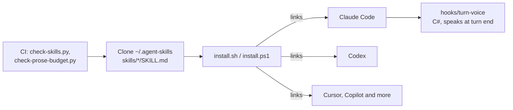

# Architecture

The repo is plain Markdown and scripts. No server and no build. The installer links one clone into each coding agent.

| Part | Technology | Job |
| --- | --- | --- |
| Skills | Markdown with front matter | Instructions the agent loads on a match |
| Installer | POSIX shell, PowerShell | Links the skills into each agent |
| Hook | C# | Speaks a line at the end of a turn |
| Checks | Python | Checks the skill format and text length |
