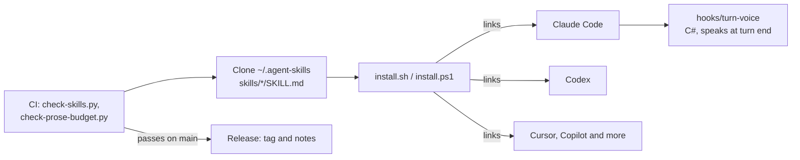

# Architecture

The repo is plain Markdown and scripts. No server and no build. The installer links one clone into each coding agent.

| Part      | Technology                 | Job                                                                   |
| --------- | -------------------------- | --------------------------------------------------------------------- |
| Skills    | Markdown with front matter | Instructions the agent loads on a match                               |
| Installer | POSIX shell, PowerShell    | Links the skills into each agent                                      |
| Hook      | C#                         | Speaks a line at the end of a turn                                    |
| Checks    | Python                     | Checks the skill format and text length                               |
| Release   | GitHub Actions, shell      | Tags each push to main that passes the checks and publishes its notes |

## Decisions

### Skill format: one Markdown folder per skill

- **Picked** `skills/<name>/SKILL.md` with frontmatter, in the Agent Skills format, plus `references/` files the skill loads on demand.
- **Why** Claude Code, Codex, Cursor, Copilot and about 50 more agents read this format, so one file serves each of them.
- **Trade-off** an agent pays tokens for each line on every run, so each skill keeps a prose cap of 300 lines. No code enforces a rule, only the agent reading it.
- **Rejected** a rules file in each agent's own format, such as Cursor rules or Copilot instructions: one copy per agent, and the copies drift.
- **Cost to undo** high: every skill, the checks and the installer assume this layout.

### Install: one clone linked into each agent

- **Picked** `install.sh` links the folders of one clone into each agent found on the machine. Git hooks in that clone relink after a `pull`, `merge`, `checkout` or `rebase`.
- **Why** an edit to a rule reaches each agent at once, and a new skill shows up without a manual rerun.
- **Trade-off** a Windows machine without Developer Mode gets junctions and a copy of the rules file, so an edit to that file needs a rerun.
- **Rejected** a copy per agent: Git Bash turns `ln -s` into a copy, and then an edit reaches none of the agents.
- **Rejected** a rerun by hand after each pull: `rewrite-repo` landed on `main` and the agents missed it until the next run.
- **Cost to undo** medium: `install.sh`, `install.ps1`, their CI jobs and the README.

### Installer language: POSIX sh, with a PowerShell wrapper

- **Picked** one `install.sh`. `install.ps1` finds the bash of Git for Windows, installs Git through `winget` when it is missing, and runs `install.sh`.
- **Why** the org stack puts installers in POSIX `sh`, and a Mac and a Linux box come with it. One script means one set of agent paths to keep.
- **Trade-off** Windows needs Git Bash, and the script carries Windows quirks such as `cygpath` and `mklink /J`.
- **Rejected** a full PowerShell installer beside `install.sh`: two copies of each agent path, and CI would need to prove both agree.
- **Rejected** only a `sh` command in the README: a Windows user opens PowerShell first.
- **Cost to undo** medium: the installer and both CI install jobs.

### Turn end voice: a C# hook built on the machine

- **Picked** `hooks/turn-voice/turn-voice.cs`, which `install.ps1` builds with the `csc.exe` that ships with Windows, then wires into `~/.claude/settings.json`.
- **Why** `csc.exe` is already on each Windows PC, so the hook needs no SDK or download to build.
- **Trade-off** the hook runs on Windows only, and it is C#, which the org stack keeps out of new code.
- **Rejected** the agent playing a sound itself: the agent skipped it, so the person heard no sound.
- **Rejected** a Rust or Node player: it would need a toolchain or a runtime on each machine to build or run. The code supports this reason, and no spec records it.
- **Cost to undo** medium: the player, its installer and the hook entries in the settings file.

### Voice: edge-tts neural voices, one language per run

- **Picked** the free Microsoft neural voices through `edge-tts`, which mise installs. The phrase splits into Cyrillic and Latin runs: `ru-RU-SvetlanaNeural` reads the Cyrillic ones and `en-GB-MaisieNeural` the Latin ones. Each run is cached in `%LOCALAPPDATA%\turn-voice`.
- **Why** a voice for one language reads its own runs with no foreign accent.
- **Trade-off** a new phrase needs the network. A failed fetch leaves only the cue.
- **Rejected** the Windows voice in `System.Speech`: robotic, and it read a phrase a second time after an `edge-tts` timeout.
- **Rejected** multilingual voices such as `en-US-EmmaMultilingualNeural` and `en-US-AvaMultilingualNeural`: they guessed a short Latin run as French.
- **Rejected** one British voice for the whole phrase: `edge-tts` has no British voice that reads Russian.
- **Cost to undo** low: the defaults in `hooks/turn-voice/install.ps1`.

### Rules on every turn: writing rules only

- **Picked** `writing-style.instructions.md` holds the short writing rules. The installer adds it to `~/.claude/CLAUDE.md`, `~/.codex/AGENTS.md` and the VS Code prompts folder.
- **Why** the agent follows the rules before the `writing-style` skill loads.
- **Trade-off** the file costs tokens on every turn, and it has to stay in step with the full skill.
- **Rejected** the spec, ship, TODO and session end rules in the same file: they made a new user's agent merge PRs and add ads unasked. They moved to `agent-skills-private`.
- **Rejected** the skill alone: the agent writes its first lines before it loads a skill.
- **Cost to undo** low: one file and the lines in `install.sh` that wire it.

### Checks: Python scripts with no packages

- **Picked** `scripts/check-skills.py` and `scripts/check-prose-budget.py`, standard library only, run through `mise x -- python`.
- **Why** they check what a Markdown linter can't see: the `name` equals the folder, the description fits the 1024 characters of the Agent Skills format, links resolve, banned words stay out, and the prose stays under its cap. No record says why Python won over TypeScript.
- **Trade-off** the org stack puts scripts in TypeScript and keeps Python for libraries Node lacks, so these scripts are an exception.
- **Rejected** markdownlint alone: it checks Markdown syntax and none of the skill rules.
- **Cost to undo** low: two scripts and their CI steps.

### Lint and format: oxfmt, ruff, shellcheck and shfmt

- **Picked** `mise run lint`: ruff for Python, oxlint for TypeScript, oxfmt for Markdown and config, shellcheck and shfmt for shell.
- **Why** the org stack wants a linter and a formatter for each language, with one tool per job.
- **Trade-off** oxfmt pads the tables in each skill, so a small edit can rewrite a whole table.
- **Rejected** ESLint and Prettier: the org stack bans them, and the `mise` and `architecture` skills now teach oxlint and oxfmt.
- **Cost to undo** low: `mise.toml` and the formatted files.

### CI and releases: GitHub runners, date tags

- **Picked** `check.yml` runs on `windows-latest` for the PowerShell install and on `ubuntu-latest` for `sh`. `release.yml` tags each green push to `main` with a date version such as `v2026.10.30.1`.
- **Why** the repo is public, so GitHub runners cost 0 minutes and fork code stays off the PC. Before the Release workflow a merge left no tagged point to go back to.
- **Trade-off** a release holds notes only, since the repo builds no file.
- **Rejected** the self-hosted `[self-hosted, local]` runner: the org keeps it for private repos, and a fork PR would run on the PC.
- **Rejected** a Linux-only check: it misses `install.ps1` and the `turn-voice` build.
- **Cost to undo** low: two workflows and their scripts.
