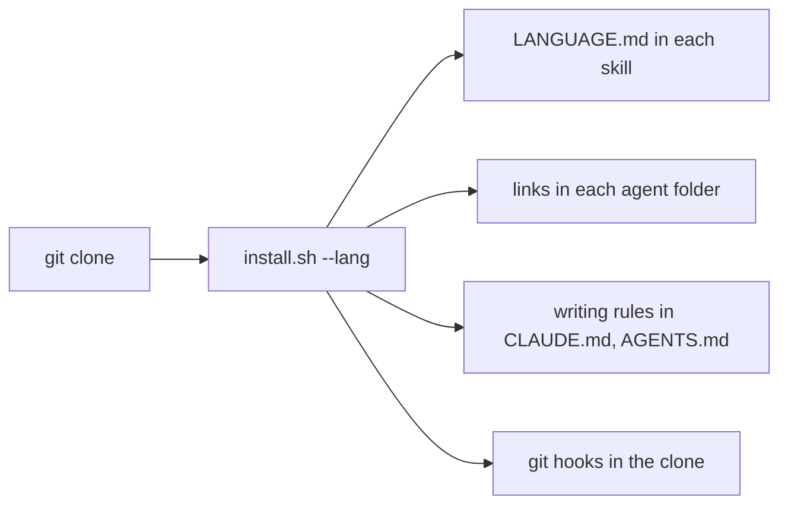
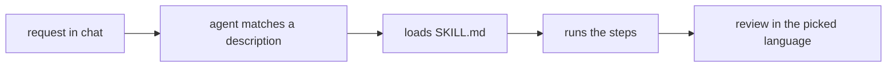
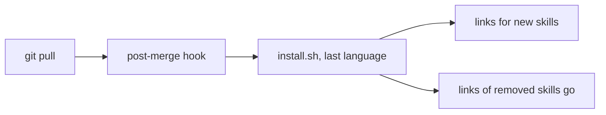
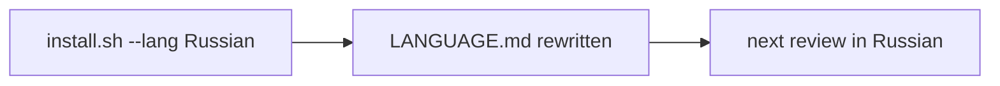
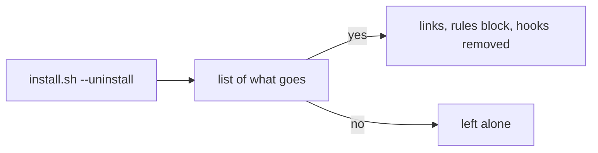

# User flows

Each flow starts in a terminal or in an agent chat. The README holds the exact
commands.

## Install

1. The person clones the repo to `~/.agent-skills`.
2. They run `install.sh`, or `install.ps1` on Windows, with `--lang`.
3. The installer writes `LANGUAGE.md` into each skill folder.
4. It links each skill into every agent folder it finds under `~`.
5. It adds the writing rules to `~/.claude/CLAUDE.md` and `~/.codex/AGENTS.md`,
   and git hooks to the clone. On Windows it also adds the turn-voice hooks.

## Use a skill

1. The person asks the agent in plain words, such as "review this PR".
2. The agent matches the request to a skill description and loads its
   `SKILL.md`.
3. The agent follows the steps. A review comes back in the language from
   `LANGUAGE.md`.

## Get new skills

1. The person runs `git pull` in the clone.
2. The git hook reruns the install with the last language.
3. A new skill gets its links, and a removed one loses them.

## Change the language

1. The person reruns the install with another `--lang`.
2. Each `LANGUAGE.md` gets the new language.

## Remove

1. The person runs the install with `--uninstall`.
2. The installer lists each link, rules block and git hook it found.
3. On a yes, or with `--yes`, it deletes them. The clone stays.

