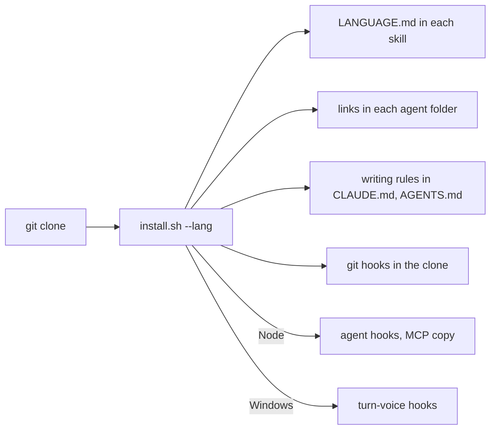
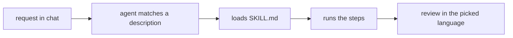
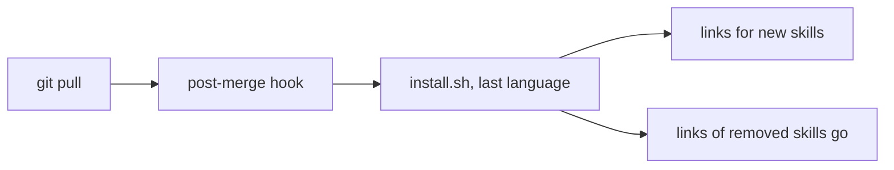
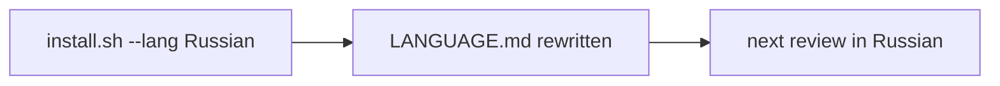
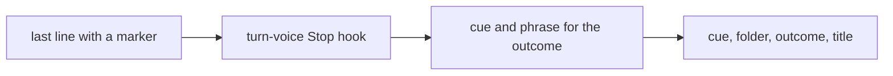
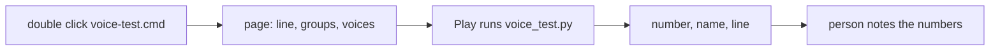
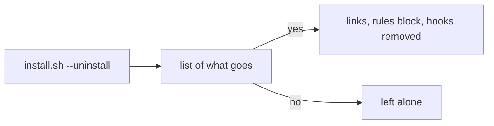

# User flows

Each flow starts in a terminal or in an agent chat. The README holds the exact
commands.

## Install

1. The person clones the repo to `~/.agent-skills`.
2. They run `install.sh`, or `install.ps1` on Windows, with `--lang`.
3. The installer writes `LANGUAGE.md` into each skill folder.
4. It links each skill into every agent folder it finds under `~`.
5. It adds the writing rules to `~/.claude/CLAUDE.md`, `~/.codex/AGENTS.md`
   and `~/.kimi-code/AGENTS.md`, and git hooks to the clone.
6. With Node on the PATH it adds the time hook to Claude Code, Codex and
   Kimi Code, the Chrome only and archive hooks to Claude Code, and copies the
   MCP servers of Claude Code to Codex and Kimi Code.
7. On Windows it also builds `turn-voice.exe` and adds its hooks to Claude
   Code, Codex and Kimi Code.

## Use a skill

1. The person asks the agent in plain words, such as "review this PR".
2. The agent matches the request to a skill description and loads its
   `SKILL.md`.
3. The agent follows the steps. A review comes back in the language from
   `LANGUAGE.md`.

## Get new skills

1. The person runs `git pull` in the clone.
2. The git hook reruns the install with the last language.
3. A new skill gets its links, and a removed one loses them.

## Change the language

1. The person reruns the install with another `--lang`.
2. Each `LANGUAGE.md` gets the new language.

## Hear the end of a turn

1. The agent ends its turn with a marker on the last line, such as
   `!!!COMPLETED!!!`.
2. Claude Code, Codex or Kimi Code runs the `turn-voice` Stop hook.
3. The hook reads the marker and picks the cue and the phrase.
4. The person hears the cue, then the folder, the outcome and the session
   title.

## Hear the voices

1. The person double clicks `voice-test.cmd`, or the desktop shortcut to it.
2. A page opens in an Edge app window. They pick the line, the groups and
   the languages, then tick the voices in the dropdown.
3. Play starts `voice_test.py` with those voices, and the page shows each
   number and voice id as it speaks.
4. Each voice says its number and name, then the chosen line.
5. They note the numbers they like, and Stop ends the run.

## Remove

1. The person runs the install with `--uninstall`.
2. The installer lists each link, rules block and git hook it found.
3. On a yes, or with `--yes`, it deletes them with the agent hooks and the
   MCP copies. The clone stays.

