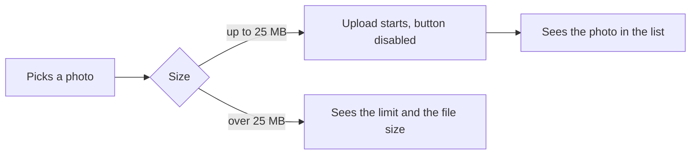
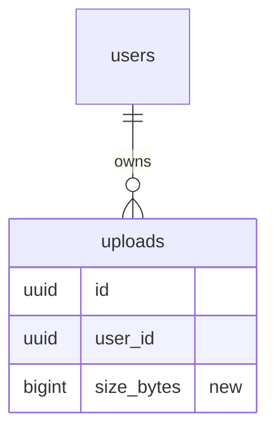
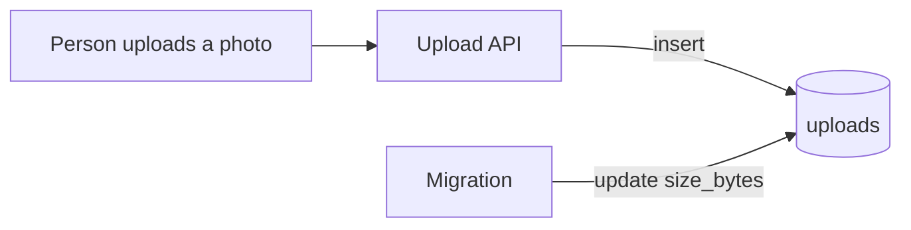

# Create a pull request

The user's request picks one of two modes:

- **Describe only**: draft the title and body, show them, and stop there.
- **Create or update**: draft them, then run `gh`. "Make a PR" asks for this
  mode.

## 1. Collect the facts

Guessing what the change does MUST NOT happen. Read the diff.

```bash
git rev-parse --abbrev-ref HEAD                  # current branch
git log --oneline "$base"..HEAD                  # commits on this branch
git diff --stat "$base"...HEAD                   # files touched
git diff "$base"...HEAD                          # the actual change
GH_PAGER=cat gh pr view --json number,title,body # PR already open?
```

`$base` stands for the branch this one was cut from. Find it once:

```bash
remote=$(git remote | grep -qx origin && echo origin || git remote | head -1)
base=$remote/$(GH_PAGER=cat gh repo view --json defaultBranchRef \
  -q .defaultBranchRef.name)
```

Most repos call the remote `origin`, but a fork or a mirror may differ. The
name MUST be read from git rather than typed.

Look for these too:

- A PR template, in `.github/pull_request_template.md` or under
  `.github/PULL_REQUEST_TEMPLATE/`.
- The commit and PR rules of the repo: `CONTRIBUTING.md`, `AGENTS.md`,
  `CLAUDE.md`.
- An issue id in the commits or the branch name (`PROJ-123`, `JIRA-123`, `#42`).

Where the repo rules and this skill disagree, the repo rules MUST win. A
template keeps the parts it requires (checkboxes, headings), with the sections
below placed inside it.

## 2. Title

The title MUST match the repo's commit convention. The usual ones:

- `PROJ-123: add page pattern examples` (issue id prefix)
- `feat(auth): add page pattern examples` (conventional commits)

Without a convention, write one short imperative sentence on what the change
does, leaving out how.

## 3. Body

The `writing-style` skill MUST be loaded before the first line, as section 4
describes.

Is there a Jira ticket for this change? Its name MUST sit alone on the body's
first line, ahead of the sections: `PROJ-123`. Give the name without a link.
Look in the branch name or the commits, ask when both lack it, and drop the line
when no ticket exists.

The sections follow, in the order below. Some are conditional:

- **`Related PRs`** only when the change builds on or goes with another PR.
- **`Data changes`** only when the diff adds or changes a database object.
- **`Try it`** only when the change adds or changes a command.
- **`Sources`** only when the work drew on something outside the repo.
- **`Generated by commands`** only when a command wrote or rewrote files in the
  diff.

The prose MUST stay under 20 lines, not counting the diagrams and command
blocks. Its reader is on a phone, in a notification, and hasn't opened the diff.

````markdown
## What problem this solves

<Who was hurting and how. One or two sentences, the symptom a person could see,
not the internals. Three symptoms or more go in bullets instead.>

## How it works now

<What the change does, in order. Two to five bullets, one line each. Each one
opens with its point in bold, then the behaviour. The file name only if it
helps.>

## Related PRs

- [<owner/repo#123>](<url>): <what this PR needs from it, or it from this PR>

## User flow

```mermaid
flowchart LR
  <what the person does and sees, step by step>
```

## Data changes

<One bullet per table: what was added, dropped or changed.>

```mermaid
erDiagram
  <the changed tables and the tables their keys point at>
```

```mermaid
flowchart LR
  <what starts the write, the step that writes, the table it lands in>
```

## Try it

```console
$ <the exact command, with real arguments>
<the output to expect>
```

## Sources

- [<what it is>](<url>): <what the change took from it>

## Reused code and packages

<What the change reuses from this repo, one line each: the name, where it sits,
what it does here. Then every dependency it adds: the name, what it does, its
size. Then the packages you looked at and turned down, with the reason. No new
package? Write "No new packages." and, if a well known package would have fit,
say why you wrote it by hand instead.>

## Generated by commands

<Which part of the diff came out of the commands below, in one line, so the
reviewer reruns them instead of reading it.>

```bash
# <the files this command wrote>
<the exact command, run from the repo root>
```
````

A bullet MUST end within two lines. Past the cap, drop a bullet and leave the
wording alone.

### User flow

The diagram traces the paths a person follows through the change. GitHub draws
the `mermaid` block as an image.

- Every path the change adds or alters MUST appear. Paths it leaves alone stay
  out.
- Each node is a screen or an action, in plain words: "Picks a photo", "Sees the
  size error". File and function names MUST stay out.
- An error, cancel or retry branch gets an arrow of its own with a label:
  `-->|over 25 MB|`.
- One diagram SHOULD hold ten nodes at most. A larger change gets a diagram per
  flow.
- A label holding brackets, quotes or a colon MUST be wrapped in double quotes,
  or GitHub can't render the block.

No person involved, like a CI job or a migration? Draw the trigger and the
result.

### Related PRs

Any PR this change builds on, copies from, waits on or must ship alongside MUST
get a link, in this repo or elsewhere. The reviewer can't judge the diff
without it. With no related PR, the section MUST be left out, and no "None" line
either.

- Look in your own session first, then the branch this one was cut from, the
  ticket links and the commit messages.
- Each line MUST hold the full URL, so the link still works from another repo.
- Each line names the tie between the two: "builds on its `formatBytes`", "the
  API side of this change", "copies its retry logic".
- When a merge order exists, it SHOULD be given: "merge after", "ship together".
- A URL MUST NOT be invented. Know of a PR but can't find it? Ask the user.

```markdown
- [acme/api#412](https://github.com/acme/api/pull/412): adds the 25 MB limit this page reads. Merge it first.
- [acme/web#87](https://github.com/acme/web/pull/87): same upload fix for the old page, this PR copies its error text.
```

### Data changes

Database objects are tables, columns, keys, indexes, constraints, views, enums
and stored procedures. They turn up in migrations, `*.sql`, schema files and ORM
models. A diff without one leaves the section out.

- **Tables** every table added or changed MUST get a bullet: the name in bold,
  then the columns added, dropped or renamed, with type and nullability.
- **Relations** the `erDiagram` MUST include each changed table and every table
  a changed key points at. A new column gets a `"new"` comment.
- **Data flow** the `flowchart` MUST trace how data gets to each changed table:
  the trigger, the step doing the write, then the table as a node.
- **Writes** an arrow into a table SHOULD be labelled: `-->|insert|`,
  `-->|update|`, `-->|delete|`.
- **Backfill** a migration that fills or moves existing rows MUST get a path of
  its own.

### Try it

Use this section for a command that is new or changed: a CLI, a script, a
`package.json` script, a Make target, a slash command, a new flag.

- Give the exact line a person types, with real arguments, then its output.
- When the command is local and safe, run it and paste the real output, cut
  down to the lines a person looks at.
- A command that needs secrets or touches shared systems MUST NOT be run. Work
  out the output from the code and put `# expected, not run` above it.
- A command that validates its input SHOULD also show one bad input and the
  error it gives.

```console
$ todo add "Buy milk" --due friday
Added #14 "Buy milk", due Fri 10 Oct
$ todo add ""
error: the title is empty
```

### Sources

Each resource outside the repo that shaped the change MUST get a link: a Figma
frame, a Confluence page, an API doc, a Slack thread, an issue in another repo.
The reviewer holds the code up against it.

- The link SHOULD land on the exact spot: the Figma frame with its `node-id`,
  the heading in the doc, the Slack message.
- Each line names what the change took from it: the error text, the spacing,
  the rate limit.
- Look in the ticket's links and attachments, your own session, the commit
  messages and the comments in the diff.
- A URL MUST NOT be invented. Used a source but lost it? Ask the user for the
  link.
- The Jira ticket belongs on the body's first line, outside this list.
- The spec the branch adds or extends under `specs/` SHOULD come first in this
  list, linked to the file on the branch.
- A pull request belongs under Related PRs, outside this list.

```markdown
- [Upload error, Figma](https://www.figma.com/design/AbC123/Uploads?node-id=12-345): the error text and its red.
- [Upload API, Confluence](https://acme.atlassian.net/wiki/spaces/API/pages/123456): the 25 MB limit.
```

### What belongs in Reused code and packages

Reused code comes first, packages after.

**Reused** is code already in the repo before this branch that the change now
calls: a helper, a component, a hook, a service, a type.

- Spot it in the imports and calls the diff adds. Code outside the files the
  branch created counts: `git diff --diff-filter=A --name-only "$base"...HEAD`.
- Each line gives the thing, its location and its job here.
- The list SHOULD end at five. Lead with what a reviewer would expect to see
  written from scratch.
- Reused code too minor to name? Drop the reused lines.

**Packages** is third party code the change now depends on, or would have. A
new peer or dev dependency counts too.

Both lists MUST leave out the repo's own tooling: Vitest, Nx, the linter. The
same goes for MCP servers, editors and agents. A command that wrote code
belongs under Generated by commands.

The diff MUST be checked before any line about packages. A package missing from
the manifest MUST NOT be claimed:
`git diff "$base"...HEAD -- '**/package.json' 'package.json'`.

Each rejected package MUST give its reason in a few words: size, unmaintained,
its licence, it pulls in a lot, the repo already covers it, or a hand-written
version takes ten lines.

Examples:

- "Reuses `formatBytes` from `src/utils/format.ts` to print the limit."
- "`date-fns` 3.6, 2 kB after tree shaking, formats the due dates."
- "Turned down `moment`: 70 kB and no tree shaking."
- "No new packages. `lodash.groupby` would have done it, but `Object.groupBy`
  ships in every browser we support."

### Generated by commands

A command goes here when it wrote or rewrote files that are in the diff: a
generator, a codemod, a `sed` or `ast-grep` rewrite, a schema or API client
generator, `pnpm add` changing the lockfile, `vitest -u` writing snapshots.

- Each command MUST be the exact line, with real arguments, in the order you
  ran them. The reviewer runs it again and diffs the output.
- Each command SHOULD have a comment above it naming the files it wrote.
- A generated file later edited by hand MUST be named, or the reviewer passes
  over it as generated.
- Commands that only read or check are left out: `git`, `grep`, tests, a build
  whose output isn't committed.

Search your own session first, the commit messages next, the diff last: a
"generated" header, a lockfile, a snapshot. A command you can't reconstruct
MUST NOT be invented. Ask the user.

```bash
# libs/upload/** and its path in tsconfig.base.json
pnpm nx g @nx/js:library upload --directory=libs/upload
# every getSize call under apps/web
ast-grep run -p 'getSize($A)' -r 'formatBytes($A)' -U apps/web
```

## 4. How to write it

The `writing-style` skill MUST be loaded first, from `writing-style/SKILL.md` in
this skills folder. It carries all the wording rules and the checklist to run
before posting, and its "Shape on the page" section decides the layout. Load it
once, unless it is already in context.

Only these rules are specific to the PR body:

- It MUST make sense on the first read, to a reader with zero context on this
  codebase.
- The section heading already names the section, so the line below it MUST
  open with the fact.
- The change MUST be described and the effort MUST NOT: what the code does now,
  no counts of lines or files, no "refactored". How the code got written goes
  only under Generated by commands.
- A guess MUST be marked as a guess.

Read the body once more before posting, and every word the reader can do
without MUST go.

## 5. Create or update the PR

Every `gh` call MUST start with `GH_PAGER=cat`, or a pager opens and the run
hangs.

If the branch has no upstream, push it first:

```bash
git push -u "$remote" HEAD
```

For a new PR:

```bash
GH_PAGER=cat gh pr create --base <base> --title "<title>" --body-file <file>
```

Put the body in a temp file instead of passing it inline, so the newlines and
backticks come through.

For an existing PR:

```bash
GH_PAGER=cat gh pr edit --title "<title>" --body-file <file>
```

`--draft` MAY be added only when the user asked for a draft.

Right after a rebase or force push, `gh pr view --json mergeable` may show a
conflict that is out of date. Any edit refreshes it, so ask again once if the
answer looks off.

## 6. Report back

Give the PR link and the title, in one or two lines, and stop there.

## Guardrails

- A push or a PR on the default branch or a protected one MUST NOT happen. Stop
  and report it.
- The problem statement MUST NOT be made up. If the diff doesn't show why the
  change exists, ask the user one question.
- A force push, an amend of published commits and `--no-verify` MUST NOT
  happen.
- Staged or untracked files unrelated to the change MUST stay as they are.

## Example body

````markdown
PROJ-123

## What problem this solves

Uploading a photo over 5 MB failed with a blank screen. People retried the same
file several times and then gave up, so support got about 30 tickets a week.

## How it works now

- **Cap** files up to 25 MB upload. The old cap was 5 MB.
- **Too big** the error names the limit and the file's own size, so the person
  knows what to do next.
- **Double submit** the upload button stays disabled while a file is in flight.

## User flow



## Data changes

- **`uploads`** new `size_bytes bigint not null`, filled from storage for old
  rows.





## Sources

- [Upload error, Figma](https://www.figma.com/design/AbC123/Uploads?node-id=12-345):
  the error text and the layout of both sizes.

## Reused code and packages

- Reuses `formatBytes` from `src/utils/format.ts` to print both sizes.
- `browser-image-compression` 2.0, 12 kB, shrinks a photo in the browser
  before it goes up.
- Turned down `sharp`: it only runs on the server, and the point here is to
  cut the upload before it starts.
- Turned down `filesize`: `formatBytes` already prints "25 MB".
````
