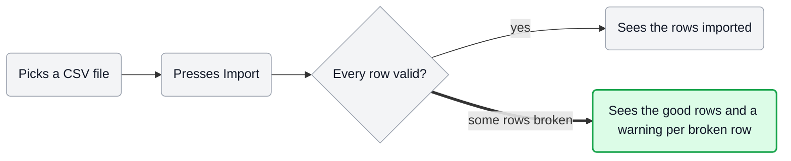
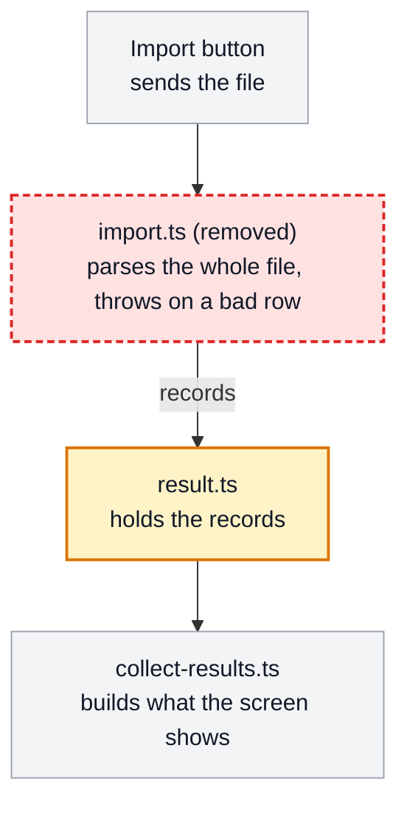
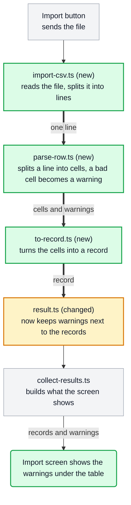

# Part 2: how the change works and the reading order

Two mermaid diagrams MUST show what the change does, each as a Before and
After pair coloured by status, as the `create-pr` skill's
`references/diagrams.md` sets out. A numbered list MUST then give the order
to open the files in. GitHub sorts files by name, so this
part spares the reader that order.

## The user flow

The diagram MUST show what a person does and sees, step by step, drawn as a
`flowchart LR`.

- Every path the change adds or alters MUST be drawn. Paths it leaves alone
  MUST stay out.
- A node MUST be an action or a screen in plain words: "Picks a CSV file". File
  and function names MUST stay out.
- A branch (error, cancel, retry) MUST get an arrow with its own label:
  `-->|some rows broken|`.

With no person involved, as with a CI job or a migration, the diagram MUST show
what triggers it and what it produces.

## What happens inside

The code path under that flow MUST be drawn as a `flowchart TD`, a node per
step.

- After its name, a node MUST say what the file does in this change. Bad:
  `parse-row.ts`. Good: `parse-row.ts (new)<br/>splits a line, a bad cell
  becomes a warning`.
- Each node MUST carry its status class: `new`, `changed`, `removed` or
  `same`.
- An arrow label MUST name what is passed on or what it alters: `-->|record|`,
  `-->|writes uploads|`. A file without a caller so far MUST connect with a
  dotted `-.->`.
- The final node MUST be the effect a person or another system sees.
- Tests and config MUST stay off it, they belong in the reading order.

When the change is only one file and a test, the agent SHOULD skip this
diagram and say in one line that it isn't needed.

## Rules for both diagrams

- A label holding brackets, quotes, a colon or a slash MUST be wrapped in
  double quotes, or the block won't render. Backticks MUST stay out of labels.
- A diagram SHOULD stay within twelve nodes per block. A larger change SHOULD get one per
  flow.

## A link under each diagram

VS Code chat renders a `mermaid` block. Claude and the terminal show it as code,
so a link that opens the picture MUST go under each block. The agent MUST
make it with `scripts/mermaid-live-url.py` from this skill's folder, passing in
the block's text:

```sh
mise x python@3 -- python <skill folder>/scripts/mermaid-live-url.py <<'EOF'
flowchart LR
  A[Picks a CSV file] --> B[Presses Import]
EOF
```

The diagram sits after the `#` in the link, a part the browser keeps from
mermaid.live, so the link MUST keep it there.

## The reading order

The list MUST be numbered, one line per file, giving the reason it comes at
that point. It SHOULD begin where the data begins or with the simplest piece,
and finish where it all connects. Each changed file MUST be listed, tests and
config at the end. The whole part SHOULD read like this:

````markdown
## How the change works

### User flow

**Before**

```mermaid
flowchart LR
  A(Picks a CSV file):::same --> B(Presses Import):::same
  B --> C{Every row valid?}:::same
  C -->|yes| D(Sees the rows imported):::same
  C -.->|some rows broken| E(Sees "Import failed", nothing saved):::removed
  classDef new fill:#dcfce7,stroke:#16a34a,stroke-width:2px,color:#111827
  classDef changed fill:#fef3c7,stroke:#d97706,stroke-width:2px,color:#111827
  classDef removed fill:#fee2e2,stroke:#dc2626,stroke-width:2px,stroke-dasharray:5 3,color:#111827
  classDef same fill:#f3f4f6,stroke:#9ca3af,color:#111827
```

[Open the diagram](<link from mermaid-live-url.py>)

**After**



[Open the diagram](<link from mermaid-live-url.py>)

Green new, amber changed, red removed, gray unchanged.

### What happens inside

**Before**



[Open the diagram](<link from mermaid-live-url.py>)

**After**



[Open the diagram](<link from mermaid-live-url.py>)

Green new, amber changed, red removed, gray unchanged.

### Reading order

1. `result.ts`, to see what a warning is. It turns up everywhere after that.
2. `to-record.ts` and `parse-row.ts`, small and self contained, read them with
   their tests.
3. `import-csv.ts`, the main file of the PR, the rest exists for it.
4. `collect-results.ts`, unchanged, but this is where you see whether the
   warnings reach the output.
5. The test and lint config, last, they only wire the new files in.
````
