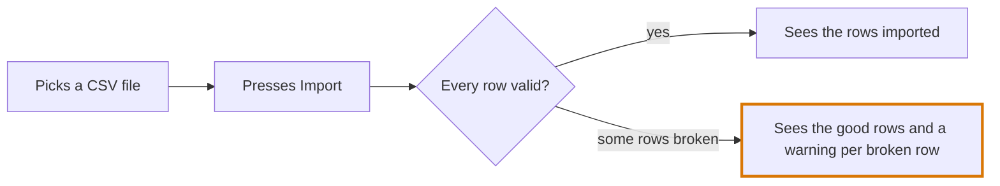
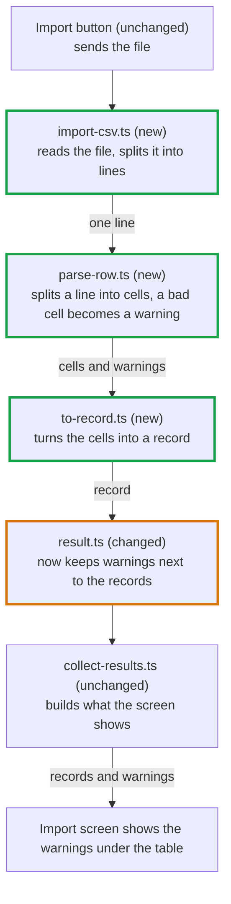

# Part 2: how the change works and the reading order

Two mermaid diagrams show what the change does, and a numbered list then gives
the order to open the files in. GitHub sorts files by name, so this part spares
the reader that order.

## The user flow

What a person does and sees, step by step, drawn as a `flowchart LR`.

- Every path the change adds or alters MUST be drawn. Paths it leaves alone
  stay out.
- A node is an action or a screen in plain words: "Picks a CSV file". File and
  function names MUST stay out.
- A branch (error, cancel, retry) gets an arrow with its own label:
  `-->|some rows broken|`.
- The step that now behaves differently gets the `changed` class.

No person involved, as with a CI job or a migration? Draw what triggers it and
what it produces.

## What happens inside

The code path under that flow, drawn as a `flowchart TD`, a node per step.

- After its name, a node MUST say what the file does in this change. Bad:
  `parse-row.ts`. Good: `parse-row.ts (new)<br/>splits a line, a bad cell
  becomes a warning`.
- Each node SHOULD carry `(new)`, `(changed)` or `(unchanged)`, and the new and
  changed ones get their class.
- An arrow label names what is passed on or what it alters: `-->|record|`,
  `-->|writes uploads|`. A file without a caller so far connects with a dotted `-.->`.
- The final node MUST be the effect a person or another system sees.
- Tests and config stay off it, they belong in the reading order.

Only one file and a test? Skip this diagram and say in one line that it isn't
needed.

## Rules for both diagrams

- A label holding brackets, quotes, a colon or a slash MUST be wrapped in
  double quotes, or the block won't render. Backticks MUST stay out of labels.
- A diagram SHOULD stay within twelve nodes. A larger change gets one per flow.

## A link under each diagram

VS Code chat renders a `mermaid` block. Claude and the terminal show it as code,
so a link that opens the picture MUST go under each diagram. Make it with
`scripts/mermaid-live-url.py` from this skill's folder, passing in the block's
text:

```sh
mise x python@3 -- python <skill folder>/scripts/mermaid-live-url.py <<'EOF'
flowchart LR
  A[Picks a CSV file] --> B[Presses Import]
EOF
```

The diagram sits after the `#` in the link, a part the browser keeps from
mermaid.live.

## The reading order

Numbered, one line per file, giving the reason it comes at that point. Begin
where the data begins or with the simplest piece, and finish where it all
connects. Each changed file MUST be listed, tests and config at the end.

````markdown
## How the change works

### User flow



[Open the diagram](<link from mermaid-live-url.py>)

### What happens inside



[Open the diagram](<link from mermaid-live-url.py>)

### Reading order

1. `result.ts`, to see what a warning is. It turns up everywhere after that.
2. `to-record.ts` and `parse-row.ts`, small and self contained, read them with
   their tests.
3. `import-csv.ts`, the main file of the PR, the rest exists for it.
4. `collect-results.ts`, unchanged, but this is where you see whether the
   warnings reach the output.
5. The test and lint config, last, they only wire the new files in.
````
